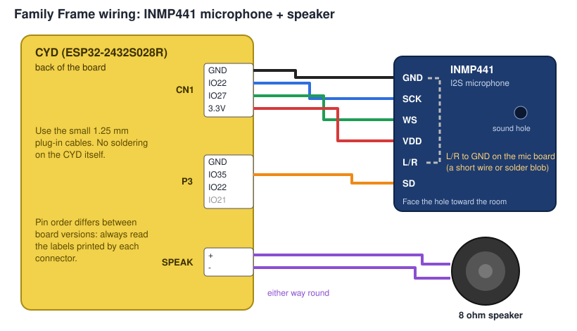

# Wiring the microphone and speaker

The picture frame and news work with no extra parts. The microphone and speaker are only needed for spoken briefings and the voice assistant.

## Parts

| Part | What to buy | Notes |
| --- | --- | --- |
| Microphone | **INMP441** I2S microphone module (6 pins: SCK, WS, L/R, SD, VDD, GND) | About $3, often sold in packs of 3. Digital, so it picks up voices much more clearly than analog mic boards. Get one with the header pins already soldered if you can. |
| Speaker | **8 ohm, 1 to 3 W** small speaker, 28 to 40 mm | One with a **1.25 mm 2-pin plug** (sold as "JST 1.25", "MX1.25" or "PH1.25") plugs straight in. Otherwise solder it to a 2-pin pigtail. |
| Cables | Two **1.25 mm 4-pin to Dupont** cables | CYDs usually come with one. You need one for CN1 and one for P3. Plain 1.25 mm 4-pin pigtails also work if you solder. |

Buzzers from Arduino or ESP32 starter kits can only beep, so they can't speak, and those kits don't include an I2S microphone.

The firmware is set up for the INMP441. Other I2S microphones (such as the SPH0645) use a slightly different data format and may need code changes.

## Connections

### Microphone (INMP441)

| INMP441 pin | Goes to | CYD connector |
| --- | --- | --- |
| VDD | 3.3V | CN1 |
| GND | GND | CN1 |
| SCK | IO22 | CN1 (IO22 is also on P3; either is fine) |
| WS | IO27 | CN1 |
| SD | IO35 | P3 |
| L/R | GND on the mic board itself | (short wire from L/R to the mic's GND pin) |

**Never use IO21 on P3.** It controls the screen's backlight.

Use **3.3V, not 5V**. The INMP441 is a 3.3 V part.

### Speaker

Plug it into the 2-pin connector labeled **SPEAK** (sometimes **P4**). Either way round is fine. The board has its own small amplifier on that connector, fed by the ESP32's GPIO 26.

## Plug-in option (almost no soldering)

If your INMP441 has header pins, and you have two 1.25 mm-to-Dupont cables (the kind with female Dupont plugs), you can push the plugs straight onto the mic's pins:

| CN1 cable wire | INMP441 pin |
| --- | --- |
| GND | GND |
| IO22 | SCK |
| IO27 | WS |
| 3.3V | VDD |

| P3 cable wire | INMP441 pin |
| --- | --- |
| IO35 | SD |
| GND | **L/R** (this ties L/R to ground, so no solder link is needed) |
| IO22 | leave unplugged, tape the end |
| IO21 | leave unplugged, tape the end |

If a cable is too short, extend it with female-to-male jumper wires from a starter kit. Keep the total length under about 20 cm. The only soldering is the six header pins on the mic, if it didn't come with them fitted.

## Soldering, step by step

You don't solder anything on the CYD. All soldering is on the microphone board and the cable ends.

1. **Check the connector labels.** Look at the small print next to CN1 and P3 on your CYD. Different board versions put the pins in a different order. Write down which colored wire of your pigtail lands on which label: plug the cable in, then follow each wire to its pin.
2. **Prepare the wires.** Cut each pigtail wire you need to about 10 to 15 cm. Shorter is better for the microphone. Strip 2 to 3 mm of insulation and twist the strands.
3. **Tin everything.** Melt a little solder onto each stripped wire end and onto each INMP441 pad you'll use. A temperature of 330 to 350 °C works well for leaded solder.
4. **Solder the L/R link first.** Bridge the INMP441's **L/R** pad to its **GND** pad with a short piece of wire. (The firmware also works if L/R goes to 3.3V instead, but it must not be left unconnected.)
5. **Solder the five wires:** VDD, GND, SCK, WS from the CN1 cable, and SD from the P3 cable. Hold each wire against its pad and touch the iron for 1 to 2 seconds.
6. **Insulate.** Slide heat-shrink tubing over each joint, or wrap it with tape. Make sure no bare wire can touch a neighbor.
7. **Leave the unused wires** on the P3 cable (GND, IO22, IO21) unconnected and taped off.
8. **Speaker:** if it didn't come with a plug, solder its two leads to a 2-pin JST 1.25 mm pigtail and insulate the joints.
9. **Mount the mic** where it isn't covered, with its sound hole facing the room (on most INMP441 boards the hole goes through the board on the side opposite the chip). Keep it away from the speaker so it doesn't hear itself.

## Test it

1. Plug in the cables and power the frame.
2. On the frame's web page, open the **Assistant** tab, tick **Microphone is connected** and **Speaker is connected**, and press **Save**.
3. Press **Test speaker**. You should hear a chime and a voice.
4. Press **Test microphone** and talk toward the frame for four seconds. The screen shows how loud it heard you, then plays your voice back.
   - *Very quiet / nothing*: check SD goes to IO35, SCK to IO22, WS to IO27, VDD to 3.3V, and that L/R is tied to GND.
   - *"A bit quiet"*: raise **Mic gain** and test again. *"Too loud"*: lower it.
   - *Crackling or the frame restarts*: use a stronger USB power supply (5 V, 2 A) and a short, thick USB cable.

You can also start both tests on the frame itself: tap the screen, tap **Add**, then **Test sound** or **Test mic**.

## Why these pins

The CYD has few free pins. The display, touch screen and SD card use most of them. The two expansion connectors expose IO22, IO27 and IO35 (input only, which suits the mic's data line). The speaker connector is wired to GPIO 26, one of the ESP32's built-in DAC outputs. The firmware uses only that DAC channel, because the other one (GPIO 25) is the touch screen's clock.

The built-in DAC is 8-bit, so voices sound like a small radio: clear, but not hi-fi. For richer sound, a MAX98357A I2S amplifier could be added later, which would need a firmware change to drive it.
