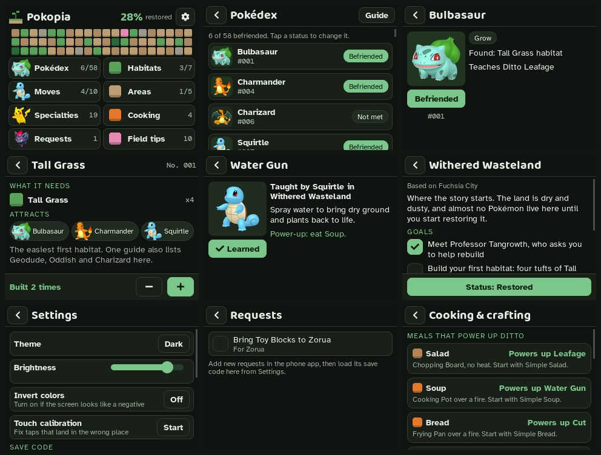

# Pokopia Companion for the Cheap Yellow Display

Firmware that runs the Pokopia Companion guide on an **ESP32-2432S028R** ("Cheap Yellow Display", or CYD): a 2.8" 320×240 touchscreen board. It's a native port of the phone app, so it has the same data, pictures and progress tracking, and needs no phone or Wi-Fi.



## What it does

- **Home**: your restoration percentage, a block map that turns green as you progress, and a tile for each section.
- **Pokédex**: tap a status to mark Pokémon *Seen* or *Befriended*. Switch between the guide's list, your befriended Pokémon, and **All** 1,025 species (20 per page). Befriending a Pokémon flashes the board's LED green.
- **Habitats**: recipes drawn as building blocks, the Pokémon each attracts, and a counter for copies built.
- **Ditto's moves**, **Specialties**, **Areas** (with goal checklists), **Cooking & crafting**, **Field tips** and **Requests**.
- **Settings**: dark or light theme, brightness, screen colors, touch calibration, and save codes.

### Moving progress between the CYD and your phone

The CYD uses the same **save code** as the phone and web app:

- **Phone to CYD**: in the app, open Journal and choose *Copy save code*. Paste the text into a file named `pokopia/save.json` on the SD card, then choose Settings › *Load from SD card* on the CYD.
- **CYD to phone**: choose Settings › *Show as QR code*, scan it with your phone's camera, copy the text and paste it into *Load save code* in the app. Or choose *Save to SD card* and copy `pokopia/save.json` across.

## Install

### 1. Pick the right firmware

| Your board | Firmware file |
| --- | --- |
| One micro-USB port (original CYD, ILI9341 screen) | `pokopia-companion-cyd-factory.bin` |
| Two ports, USB-C and micro-USB ("CYD2USB", ST7789 screen) | `pokopia-companion-cyd2usb-factory.bin` |

If you're not sure, try the first one. If the screen stays white or garbled, flash the other file.

### 2. Flash it from your browser (no installs)

1. Use **Chrome or Edge on a computer** and plug the CYD in with a USB **data** cable.
2. Open <https://espressif.github.io/esptool-js/> and click **Connect**. Pick the board's serial port (often "CP210x" or "CH340").
3. Under *Flash Address* enter `0x0`, choose the `.bin` file, and click **Program**.
4. When it finishes, press the board's **RST** button.

If Connect fails, hold the **BOOT** button while you click Connect. On Windows you may need the CH340 or CP210x USB driver.

### 3. First start: touch and color setup

The first time the board starts, it walks you through two quick steps before Home:

1. **Touch**: tap the center of a target in the top-left corner, then one in the bottom-right. A stylus or fingernail works best.
2. **Colors**: four test boxes are labeled Red, Green, Blue and White. If they look like a photo negative, tap **Invert**. If red and blue are swapped, tap **Swap red/blue**. The screen changes right away. When the boxes match their labels, tap **Looks right**.

To run setup again at any time, **hold the screen or the BOOT button while the board starts**. That's useful if taps land in the wrong place and you can't reach Settings. Both steps are also in Settings.

### 4. Optional: pictures for all 1,025 Pokémon

The firmware already has pictures of the guide's 55 built-in Pokémon. For every other Pokémon (the **All** list), copy the SD card pack to a FAT32 microSD card:

- Unzip `pokopia-sd-card.zip` so the card's root has a `pokopia` folder, **or**
- build it yourself with `python3 tools/make_sd_card.py /path/to/card`.

Without the card, those Pokémon show their first letter instead.

## Build it yourself

You need [PlatformIO](https://platformio.org/install/cli) (`pip install platformio`).

```sh
cd cyd
pio run -e cyd                 # or -e cyd2usb
pio run -e cyd -t upload       # build and flash over USB
pio device monitor             # serial log, 115200 baud
```

Each build also writes `.pio/build/<env>/pokopia-companion-<env>-factory.bin`, the single file for browser flashing. Every push that changes this folder also builds both firmware files and the SD card pack on GitHub Actions (see the repository's **Actions** tab).

### How it's put together

```
cyd/
  src/main.cpp        hardware: display (TFT_eSPI), touch (XPT2046), backlight, LED, LittleFS, SD
  src/app/            the UI (LVGL 9) and save state. Same code runs in the PC simulator
  src/gen/            generated from ../web: guide data, 1,025 names, built-in sprites, fonts
  include/lv_conf.h   LVGL settings
  sim/                PC simulator: renders the UI to screenshots from a script of taps
```

The guide data is generated from the web app, so `web/data.js` stays the single source of truth. After editing it, regenerate the C++ sources:

```sh
python3 tools/gen_cyd_assets.py    # data, species list, built-in sprites (needs Node.js + Pillow)
python3 tools/gen_cyd_fonts.py     # fonts (needs fontTools + Node.js; run `pio pkg install` first)
```

### PC simulator

`sim/` compiles the same UI for Linux and writes screenshots, so you can check layouts without the board:

```sh
cd cyd && pio pkg install          # fetches LVGL and ArduinoJson sources
cd sim && make
python3 ../../tools/make_sd_card.py sd   # optional: SD pictures for the simulator
mkdir -p data && printf 'shot home.ppm\ntap 80 105\nshot dex.ppm\n' | ./build/sim data
```

## Hardware notes

| Part | Pins |
| --- | --- |
| Display (HSPI) | MOSI 13, MISO 12, SCK 14, CS 15, DC 2, backlight 21 |
| Touch XPT2046 (bit-banged) | CLK 25, MOSI 32, MISO 39, CS 33 |
| microSD (VSPI) | SCK 18, MISO 19, MOSI 23, CS 5 |
| RGB LED (active low) | R 4, G 16, B 17 |

Touch is read in software so the SD card can keep the hardware SPI bus. Progress is saved to the ESP32's flash (LittleFS) about two seconds after each change.

## Credits

Unofficial fan project for personal use. Not affiliated with or endorsed by Nintendo, The Pokémon Company or Game Freak. Pokémon images are © Nintendo, Creatures Inc. and GAME FREAK inc., via [Pokémon Database](https://pokemondb.net/sprites). Built with [LVGL](https://lvgl.io), [TFT_eSPI](https://github.com/Bodmer/TFT_eSPI) and [ArduinoJson](https://arduinojson.org). Fonts: Atkinson Hyperlegible, Baloo 2 and DM Mono under the SIL Open Font License.
